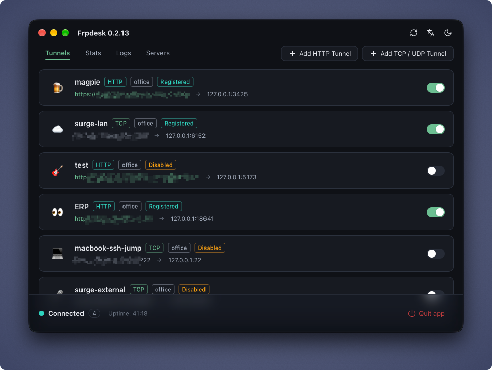

[English](README.md) | 简体中文


# Frpdesk

Frpdesk 是 [frp](https://github.com/fatedier/frp) 的桌面客户端，通过图形界面将本地网站、API 和 TCP/UDP 服务开放到公网，无需手写客户端配置文件或单独运行 frpc。



## 功能

- HTTP、TCP、UDP 隧道
- 多 FRPS 服务器配置
- 服务状态、日志与 HTTP 请求统计
- macOS 菜单栏后台常驻
- 内置 HTTP 代理，支持 CORS 与 Host 改写
- 中英文界面与应用内更新

## 安装

前往 [GitHub Releases](https://github.com/ivanusong/frpdesk/releases/latest)，下载适合你设备的安装包：

| 平台 | 安装包 | 安装方式 |
| --- | --- | --- |
| macOS 12+（Apple Silicon） | `darwin-arm64.zip` | 解压后将应用拖入「应用程序」 |
| macOS 12+（Intel） | `darwin-amd64.zip` | 解压后将应用拖入「应用程序」 |
| Windows（x64） | `windows-amd64.exe` | 下载后直接运行 |
| Windows（ARM64） | `windows-arm64.exe` | 下载后直接运行 |
| Linux（x64） | `linux-amd64.tar.gz` | 解压后运行 `./frpdesk` |
| Linux（ARM64） | `linux-arm64.tar.gz` | 解压后运行 `./frpdesk` |

完整文件名会在上述平台后缀前包含应用名称和版本号。安装后可在应用内检查更新。

Linux 包面向 Ubuntu 24.04 或兼容的桌面系统，需要 GTK 4 与 WebKitGTK 6.0；Ubuntu 可执行 `sudo apt install libgtk-4-1 libwebkitgtk-6.0-4` 安装。Windows 和 Linux 的许可文档可下载发布页中单独的 `licenses.zip` 附件。

## 服务端准备（FRPS）

Frpdesk 只是客户端，仍需一台可用的 [frps](https://github.com/fatedier/frp) 服务器。Frpdesk 内置的 frp 客户端为 v0.71.0，服务端版本应不低于该版本。

如果你有自己的服务器和域名，直接使用 [`server/`](server) 目录里现成的 Docker Compose 方案：frps 跑在 Traefik 后面，由 Traefik 自动签发并续期泛域名证书。你只需要改一个 `.env` 文件，然后执行 `docker compose up -d`。详细步骤见 [用 Docker Compose 部署服务端](docs/server_zh-CN.md)。

如果 frps 地址是别人给你的，跳过本节，直接看下面的「快速使用」。

想自己跑 frps 而不用 Docker 时，最小配置只需四项。把 `vhostHTTPPort` 设成与 `bindPort` 相同，一个端口即可同时服务客户端控制连接与 HTTP 入口：

```toml
# frps.toml
bindAddr = "0.0.0.0"
bindPort = 7000                       # 对应应用中的「服务器端口」

auth.method = "token"
auth.token = "a-long-random-secret"   # 对应应用中的「鉴权 Token」

# 仅 HTTP 隧道需要；只用 TCP/UDP 服务时这两行可以去掉
vhostHTTPPort = 7000                  # 与 bindPort 相同
subDomainHost = "example.com"         # 对应应用中的「根域名」，不带 "*."
```

防火墙放通 `bindPort` 与每个 TCP/UDP 服务的远程端口，并把泛域名 `*.example.com` 解析到服务器公网 IP。这样只提供 `http://` 访问；frps 自身无法为 HTTP 隧道终结 TLS，要 `https://` 请使用上面的 Compose 方案。

## 快速使用

使用前需要准备一台可连接的 **FRPS 服务器**，以及服务器地址、端口和鉴权 Token（如已启用）。

1. 打开 Frpdesk，在「配置」中添加 FRPS 服务器信息，字段含义见上文的「服务端准备」。
2. 新增 HTTP、TCP 或 UDP 服务，选择目标服务器，填写本地 IP 和端口，例如 `127.0.0.1:3000`。
3. HTTP 服务填写子域名前缀；TCP/UDP 服务填写远程端口。使用 HTTP 前，需要先在服务端配置 HTTP 域名入口和泛域名解析，再在应用的服务器配置中启用「支持 HTTP 域名」并填写对应的公开入口信息。
4. 启用服务器和服务，通过界面显示的访问地址连接本地服务。连接失败时可在应用内查看状态与日志。

## 许可证

[Apache-2.0](LICENSE)。第三方声明见 [THIRD_PARTY_NOTICES.md](THIRD_PARTY_NOTICES.md)。
